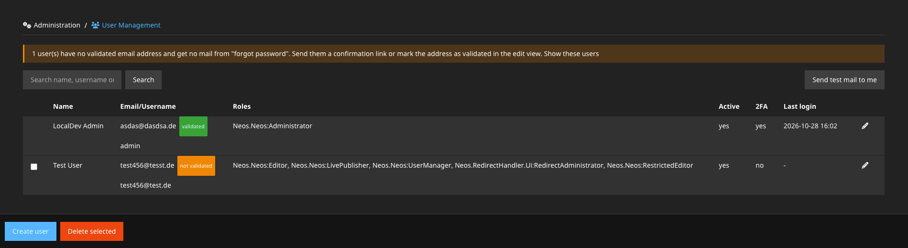
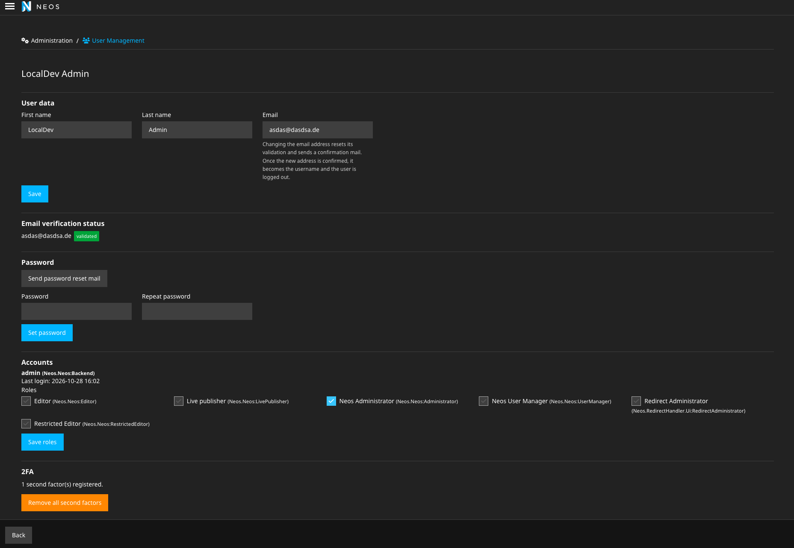

# Sandstorm.BackendUserManagement

Backend user management for Neos 8 and 9: forgot password, initial password via mail, email validation, a
replacement for the core user module, second factors (TOTP, passkeys) and passwordless passkey login.

Successor of `sandstorm/neostwofactorauthentication` (abandoned) - upgrading? See [MIGRATION.md](docs/MIGRATION.md).

```
composer require sandstorm/backendusermanagement
./flow doctrine:migrate
```

All settings with their defaults: [`Settings.UserManagement.yaml`](Configuration/Settings.UserManagement.yaml),
[`Settings.2FA.yaml`](Configuration/Settings.2FA.yaml).

**Features**

- [User management](#user-management)
  - [Forgot password](#forgot-password)
    - [Existing users](#existing-users)
  - [Initial password](#initial-password)
  - [Email validation](#email-validation)
  - [Username follows the email](#username-follows-the-email) (opt-in)
  - [User management module simplified UI](#user-management-module-simplified-ui) (opt-in)
  - [CLI](#cli)
- [Second factors](#second-factors)
  - [TOTP (authenticator apps)](#totp-authenticator-apps)
  - [Passkeys (WebAuthn / FIDO2)](#passkeys-webauthn--fido2)
  - [Enforce 2FA](#enforce-2fa)
  - [Passwordless passkey login](#passwordless-passkey-login) (opt-in)
  - [Reload on session timeout](#reload-on-session-timeout)

---

## User management

**On by default**: forgot password and the CLI commands. Optional: the [user management module](#user-management-module)
and [username follows the email](#username-follows-the-email). Mails are sent via
[neos/symfonymailer](https://github.com/neos/symfonymailer) - configure `Neos.SymfonyMailer.mailer.dsn` and:

```yaml
Sandstorm:
  BackendUserManagement:
    userManagement:
      # only accounts of these providers are managed
      authenticationProviders: ['Neos.Neos:Backend']
      mail:
        from:
          address: 'no-reply@example.com'   # required - without it, no mail is sent (error in the security log)
          name: 'My CMS'

Neos:
  Flow:
    http:
      # required for the CLI commands (links in mails)
      baseUri: 'https://cms.example.com/'
```

To turn it off: `Sandstorm.BackendUserManagement.userManagement.enabled: false`.

Add a daily cron job for `./flow usermanagement:prunetokens`.

Links in mails are single-use, stored as SHA-256 hashes, expire, are invalidated by a newer link of the same kind, and
are only consumed on POST (mail scanners prefetch). Setting a password logs out all sessions of the user and never
logs in, so 2FA stays in force.

```yaml
Sandstorm:
  BackendUserManagement:
    userManagement:
      # ISO 8601 durations
      tokenLifetime:
        resetPassword: 'PT24H'
        initialPassword: 'P7D'
        verifyEmail: 'P7D'
      passwordPolicy:
        minimumLength: 1
        maximumLength: 255
```

### Forgot password

"Forgot your password?" on the login screen. Users enter username or email and get a link to set a new password. The
response is identical whether an account exists or not; several accounts sharing an email get one mail.

```yaml
Sandstorm:
  BackendUserManagement:
    userManagement:
      # only send to validated primary email addresses
      requireValidatedEmail: true
```

#### Existing users

Users created before (e.g. via the core user module) usually have no or no validated email address:

- **They get no mail.** The response is still the generic one; only the security log has a warning. Validate their
  addresses with `./flow usermanagement:setemail <username> <email> --validated` or, in the
  [user management module](#user-management-module), send them a confirmation link or "Mark as validated" (its index
  shows how many users are affected).
- **Shared addresses:** all accounts sharing an email get their links in one mail to it. Find them with
  `./flow usermanagement:duplicateemails` and give each user its own address.
- `requireValidatedEmail: false` covers them without validating, but sends links to addresses nobody ever confirmed
  (possibly stale or mistyped) - not recommended.

#### Mail queue

Forgot-password mails go through a [Flowpack.JobQueue.Common](https://github.com/Flowpack/jobqueue-common) queue so
the response time does not leak whether an account exists. Default: async `FakeQueue` (one background `./flow`
process per mail, needs `exec()` and `Neos.Flow.core.phpBinaryPathAndFilename`). For a real queue:

```yaml
Flowpack:
  JobQueue:
    Common:
      queues:
        'Sandstorm.BackendUserManagement:UserManagementMail':
          className: 'Flowpack\JobQueue\Redis\Queue\RedisQueue'   # then run ./flow job:work
```

Never set `async: false` - the request would wait for the mail again.

#### Throttle

Requests are rate-limited per username/email and per IP
([symfony/rate-limiter](https://symfony.com/doc/current/rate_limiter.html), sliding window):

```yaml
Sandstorm:
  BackendUserManagement:
    userManagement:
      throttle:
        perIdentifier:
          limit: 3
          window: 'PT15M'
        perIp:
          enabled: true
          limit: 50
          window: 'PT15M'
        # symfony/lock DSN
        lockStore: 'flock'
```

**Behind a reverse proxy**, trust it - otherwise all clients share the proxy's IP and the per-IP limit becomes
global. Don't use `'*'`, clients could then spoof `X-Forwarded-For`:

```yaml
Neos:
  Flow:
    http:
      trustedProxies:
        proxies:              # or env FLOW_HTTP_TRUSTED_PROXIES
          - '10.0.0.0/8'
```

If you can't (or a WAF already limits requests), disable the per-IP limit instead with `throttle.perIp.enabled: false`.

**Several Neos containers**: limiter state and lock default to the local file system, so each container counts on
its own. Share both, e.g. via Redis (needs the PHP `redis` extension; `redis://` lock store needs `symfony/cache`):

```yaml
# Configuration/Caches.yaml
Sandstorm_BackendUserManagement_Throttle:
  backend: Neos\Cache\Backend\RedisBackend
  backendOptions:
    hostname: 'redis'
    port: 6379
    database: 2
```

```yaml
# Configuration/Settings.yaml
Sandstorm:
  BackendUserManagement:
    userManagement:
      throttle:
        lockStore: 'redis://redis:6379'
```

### Initial password

Administrators create users without a password; the user gets a link to set one (lifetime:
`tokenLifetime.initialPassword`). Setting a password via a link also validates the email address.

### Email validation

The user's primary email (Neos.Party `ElectronicAddress`, `approved` = validated). Changing it resets validation and
sends a confirmation mail (lifetime: `tokenLifetime.verifyEmail`); admins can also mark it as validated.

### Username follows the email

```yaml
Sandstorm:
  BackendUserManagement:
    userManagement:
      usernameIsEmail: true   # default: false
```

New accounts are named after the email (username field hidden). On email change, accounts named after the old address
are renamed once the new one is validated; the user is logged out everywhere and gets a mail with the new username.
If the name is taken, the rename is skipped (flash message, security log). On Neos 8 the personal workspace is
migrated with its unpublished changes.

### User management module simplified UI

`Administration > User Management`, replacing the core user module with a simplified UI: search, bulk delete, create, edit (name, email,
roles per account, active, password), send reset / initial password / confirmation mails, reset second factors,
impersonate, send a test mail to yourself.





```yaml
Neos:
  Neos:
    modules:
      administration:
        submodules:
          users:
            enabled: false   # core module
          userManagement:
            enabled: true
```

Permissions mirror the core module: `Neos.Neos:Administrator` manages everybody, `Neos.Neos:UserManager` only users
with the same or a subset of their roles. Nobody can delete, deactivate or lock out themselves.

### CLI

The mail commands require `userManagement.enabled` and `Neos.Flow.http.baseUri`. Commands taking a `<username>` also
accept `--authentication-provider` (default: first of `authenticationProviders`).

| Command                                                     |                                                  |
|-------------------------------------------------------------|--------------------------------------------------|
| `usermanagement:sendinitialpassword <username>`             | mail a "set your password" link                  |
| `usermanagement:sendreset <username>`                       | mail a "reset your password" link                |
| `usermanagement:setemail <username> <email> [--validated]`  | set the primary email (e.g. legacy users)        |
| `usermanagement:duplicateemails`                            | list users sharing a primary email (legacy data) |
| `usermanagement:prunetokens`                                | delete used/expired links (cron)                 |

---

## Second factors

Users register any number of second factors in `Management > Two-Factor Authentication` and pick one at login.
Administrators can delete factors of other users (e.g. after a lockout).


### TOTP (authenticator apps)

Tested with Google Authenticator, Microsoft Authenticator, Authy and 1Password.

```yaml
Sandstorm:
  BackendUserManagement:
    secondFactor:
      # label shown in the authenticator app; empty = site name
      issuerName: ''
      # accepted clock drift in seconds (codes from now-leeway to now+leeway); 0 = exact; values >= 30 are clamped to 29
      totpLeewayInSeconds: 0
```

### Passkeys (WebAuthn / FIDO2)

Platform authenticators (Touch ID, Windows Hello) and security keys (e.g. YubiKey). Requires HTTPS; an IP address
cannot be the relying-party id.

```yaml
Sandstorm:
  BackendUserManagement:
    secondFactor:
      webAuthn:
        # shown in the browser prompt
        relyingPartyName: 'Neos Backend'
        # null = request hostname; set the registrable domain ('example.com') to share credentials across subdomains
        relyingPartyId: null
        # 'discouraged' | 'preferred' | 'required' - applies to passkeys as 2nd factor only.
        # 'required' excludes U2F-only keys (e.g. YubiKey 4).
        userVerification: 'discouraged'
        # browser ceremony timeout in ms
        timeout: 60000
```

| Authenticator                    | 2nd factor, `discouraged` | 2nd factor, `required` | Passwordless |
|----------------------------------|---------------------------|------------------------|--------------|
| YubiKey 5 / FIDO2 keys           | ✅ touch                  | ✅ PIN + touch         | ✅           |
| YubiKey 4 / U2F-only keys        | ✅ touch                  | ❌                     | ❌           |
| Touch ID, Windows Hello          | ✅                        | ✅                     | ✅           |

Attestation is always `none` (formats `none` and `fido-u2f` are accepted); there is no setting for it.

#### Local development over plain HTTP

webauthn-lib rejects every `http://` host - including `localhost` - with `Invalid scheme. HTTPS required.` unless
listed here. Development context only, never in production:

```yaml
# Configuration/Development/Settings.yaml
Sandstorm:
  BackendUserManagement:
    secondFactor:
      webAuthn:
        securedRelyingPartyIds:
          - 'localhost'
          - 'myproject.localhost'
```

### Enforce 2FA

Users without a second factor have to set one up before they can log in.

```yaml
Sandstorm:
  BackendUserManagement:
    secondFactor:
      # for all users
      enforceForAll: true
      # or only for these authentication providers ...
      enforceForAuthenticationProviders: ['Neos.Neos:Backend']
      # ... and/or roles
      enforceForRoles: ['Neos.Neos:Administrator']
```


### Passwordless passkey login

A "Sign in with a passkey" button on the login screen - no username, no password. A user-verified passkey counts as
both factors. [Demo video](https://github.com/user-attachments/assets/29907363-ccda-4417-b501-e36921869e47)

```yaml
Sandstorm:
  BackendUserManagement:
    secondFactor:
      webAuthn:
        passwordlessLoginEnabled: true   # default: false, enforced server-side
```

- Only **discoverable** credentials with user verification work. Credentials registered while this was off, and
  U2F-only keys, stay 2nd-factor only (badge "Passkey as 2nd factor" vs. "Passkey" in the module).
- While enabled, new registrations can be a passkey or a touch-only security key as 2nd factor.
- Users without a passkey see a "Register a passkey" banner in the module.

### Reload on session timeout

When the backend session expires, the Neos UI reloads the page instead of showing the core relogin dialog (which
cannot handle the second factor). No configuration.

---

## Fragile on Neos upgrades

- The 2FA login screen is a copy of the `Neos.Neos` login screen.
- The passkey button is injected into the core login screen via `Configuration/Views.yaml` and a `@process` on
  `Neos.Neos:Component.Login.Form`.

## Development

E2E tests (Playwright + playwright-bdd, Neos 8 and 9 in Docker), run from `Tests/E2E/`:

```bash
make setup   # once
make test    # all variants; `make help` lists the rest
```

Details: [Tests/E2E/README.md](Tests/E2E/README.md).
