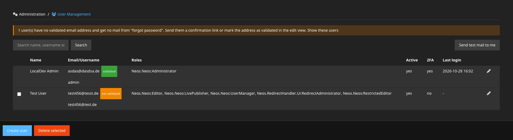
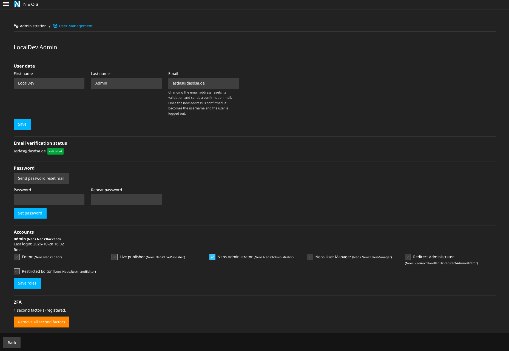

# Sandstorm.BackendUserManagement

Backend user management for Neos 8 and 9:

- **Self-service passwords**: "forgot password" on the login screen, initial password via mail, email validation.
- **User management module**: a simplified replacement for the core user module (opt-in).
- **Second factors**: TOTP and passkeys, optionally enforced per role / provider / for everybody.
- **Passwordless login** with a passkey (opt-in).

Successor of `sandstorm/neostwofactorauthentication` (abandoned) - upgrading? See [MIGRATION.md](docs/MIGRATION.md).

**Contents**
- [Getting started](#getting-started)
- [Features](#features)
  - [User management](#user-management)
    - [forgot password](#forgot-password)
    - [initial password](#initial-password)
    - [email validation](#email-validation)
    - [username follows the email](#username-follows-the-email)
    - [user management module](#user-management-module)
    - [CLI commands](#cli-commands)
  - [Second factors](#second-factors)
    - [TOTP](#totp-authenticator-apps)
    - [passkeys](#passkeys-webauthn--fido2)
    - [enforce 2FA](#enforce-2fa)
    - [passwordless passkey login](#passwordless-passkey-login)
- [Configuration reference](#configuration-reference)
- [Development](#development)

---

## Getting started

### Install

```bash
composer require sandstorm/backendusermanagement
./flow doctrine:migrate
```

Then add a **daily cron job** that deletes used and expired links:

```bash
./flow usermanagement:prunetokens
```

### Minimal configuration (required)

User management is **on** after installing. It sends mails, so these are required - without them no mail is sent
(the module shows a warning, "forgot password" logs an error in the security log):

```yaml
Neos:
  SymfonyMailer:
    mailer:
      dsn: 'smtp://mailer:25'

Sandstorm:
  BackendUserManagement:
    userManagement:
      mail:
        # Base URI of the links in mails. Omit if Neos.Flow.http.baseUri is set (usually not the case in multi-site
        # setups). Never taken from the request for security reasons.
        baseUri: 'https://cms.example.com/'
        from:
          address: 'no-reply@example.com'
```

Depending on your setup:

- **behind a reverse proxy**: [trust it](#throttle), otherwise the per-IP throttle becomes a global one,
- **several Neos containers**: [share the throttle state](#running-several-neos-containers).

Existing users usually have no validated email address and therefore can't use "forgot password" yet - see
[existing users](#existing-users).

### All features

On top of the minimal configuration, enable the opt-in features:

```yaml
Neos:
  Neos:
    modules:
      administration:
        submodules:
          users:
            enabled: false            # core user module
          userManagement:
            enabled: true             # user management module

Sandstorm:
  BackendUserManagement:
    userManagement:
      usernameIsEmail: true           # username follows the email
    secondFactor:
      enforceForAll: true             # enforce 2FA (or per role / provider)
      webAuthn:
        passwordlessLoginEnabled: true
```

### Screenshots

**User management module** (`Administration > User Management`): search, create and bulk delete users; see at a
glance whose email is validated, who uses 2FA and when they last logged in. A notice lists users who can't use
"forgot password" yet.



**Edit a user:** name and email (with validation status), send a password reset mail or set a password, roles per
account, remove all second factors.



**Second factors** (`Management > Two-Factor Authentication`): users register passkeys, authenticator apps (OTP)
and security keys as a second factor, and delete them. Shown with passwordless login enabled.


**Enforced 2FA:** users without a second factor must set one up during login: a passkey, an authenticator app
or a passkey as a second factor.


---

## Features

| Feature                                                                               | Default                 | Toggle                                                                                                                 |
|---------------------------------------------------------------------------------------|-------------------------|------------------------------------------------------------------------------------------------------------------------|
| [Forgot password](#forgot-password)                                                   | on                      | `Sandstorm.BackendUserManagement.userManagement.enabled`                                                               |
| [Initial password](#initial-password)                                                 | on                      | `Sandstorm.BackendUserManagement.userManagement.enabled`                                                               |
| [Email validation](#email-validation)                                                 | on                      | `Sandstorm.BackendUserManagement.userManagement.enabled`                                                               |
| [Username follows the email](#username-follows-the-email)                             | off                     | `Sandstorm.BackendUserManagement.userManagement.usernameIsEmail`                                                       |
| [User management module](#user-management-module)                                     | off                     | `Neos.Neos.modules.administration.submodules.userManagement.enabled`                                                   |
| [CLI commands](#cli-commands)                                                         | on                      | `Sandstorm.BackendUserManagement.userManagement.enabled`                                                               |
| [TOTP](#totp-authenticator-apps), [passkeys](#passkeys-webauthn--fido2) as 2nd factor | on (voluntary per user) | -                                                                                                                      |
| [Enforce 2FA](#enforce-2fa)                                                           | off                     | `Sandstorm.BackendUserManagement.secondFactor.enforceForAll` / `enforceForAuthenticationProviders` / `enforceForRoles` |
| [Passwordless passkey login](#passwordless-passkey-login)                             | off                     | `Sandstorm.BackendUserManagement.secondFactor.webAuthn.passwordlessLoginEnabled`                                       |

Each feature lists its **minimal** configuration (what you have to set) and **all options** (defaults shown). The
complete list is in the [configuration reference](#configuration-reference).

## User management

**On by default.** Turn it off completely (public endpoints, login screen link, CLI commands) with:

```yaml
Sandstorm:
  BackendUserManagement:
    userManagement:
      enabled: false
```

**Minimal:** see [getting started](#minimal-configuration-required).

**All options** shared by the user management features:

```yaml
Sandstorm:
  BackendUserManagement:
    userManagement:
      enabled: true
      # only accounts of these providers are managed
      authenticationProviders: ['Neos.Neos:Backend']
      # ISO 8601 durations
      tokenLifetime:
        resetPassword: 'PT24H'
        initialPassword: 'P7D'
        verifyEmail: 'P7D'
      passwordPolicy:
        minimumLength: 1
        maximumLength: 255
      mail:
        baseUri: ~                    # falls back to Neos.Flow.http.baseUri
        from:
          address: ~                  # required
          name: 'Neos'
```

How links in mails behave:

- Each link works once and expires (see `tokenLifetime`).
- Sending a new link of the same kind invalidates the old one.
- Only a SHA-256 hash of the link is stored.
- Opening a link does nothing yet; it is only used up when the user submits the form. Mail scanners that open links
  automatically therefore can't burn them.

Setting a password logs the user out of all sessions. It does not log them in - they log in normally afterwards,
including their second factor.

### Forgot password

**On by default.** "Forgot your password?" on the login screen. Users enter username or email and get a link to set a
new password. The response is identical whether an account exists or not; several accounts sharing an email get one
mail.

**Minimal:** nothing beyond [getting started](#minimal-configuration-required).

**All options:**

```yaml
Sandstorm:
  BackendUserManagement:
    userManagement:
      # only send to validated primary email addresses
      requireValidatedEmail: true
      tokenLifetime:
        resetPassword: 'PT24H'
      throttle:                       # see "Throttle"
        perIdentifier:
          limit: 3
          window: 'PT15M'
        perIp:
          enabled: true
          limit: 50
          window: 'PT15M'
        lockStore: 'flock'
```

#### Existing users

Users created before (e.g. via the core user module) usually have no or no validated email address:

- **They get no mail.** The response is still the generic one; only the security log has a warning. Validate their
  addresses with `./flow usermanagement:setemail <username> <email> --validated` or, in the
  [user management module](#user-management-module), send them a confirmation link or "Mark as validated" (its index
  shows how many users are affected).
- **Shared addresses:** all accounts sharing an email get their links in one mail to it. Find them with
  `./flow usermanagement:duplicateemails` and give each user its own address.
- `requireValidatedEmail: false` covers them without validating, but sends links to addresses nobody ever confirmed
  (possibly stale or mistyped) - not recommended.

#### Mail queue

Forgot-password mails go through a [Flowpack.JobQueue.Common](https://github.com/Flowpack/jobqueue-common) queue so
the response time does not leak whether an account exists. Default: async `FakeQueue` (one background `./flow`
process per mail, needs `exec()` and `Neos.Flow.core.phpBinaryPathAndFilename`). For a real queue:

```yaml
Flowpack:
  JobQueue:
    Common:
      queues:
        'Sandstorm.BackendUserManagement:UserManagementMail':
          className: 'Flowpack\JobQueue\Redis\Queue\RedisQueue'   # then run ./flow job:work
```

Never set `async: false` - the request would wait for the mail again.

#### Throttle

Requests are rate-limited per username/email and per IP
([symfony/rate-limiter](https://symfony.com/doc/current/rate_limiter.html), sliding window). Options: see
[forgot password](#forgot-password).

**Behind a reverse proxy**, trust it - otherwise all clients share the proxy's IP and the per-IP limit becomes
global. Don't use `'*'`, clients could then spoof `X-Forwarded-For`:

```yaml
Neos:
  Flow:
    http:
      trustedProxies:
        proxies:              # or env FLOW_HTTP_TRUSTED_PROXIES
          - '10.0.0.0/8'
```

If you can't (or a WAF already limits requests), disable the per-IP limit instead with `throttle.perIp.enabled: false`.

#### Running several Neos containers

Limiter state and lock default to the local file system, so each container counts on its own. This also applies to
the [TOTP throttle](#totp-authenticator-apps). Share both, e.g. via Redis (needs the PHP `redis` extension;
`redis://` lock store needs `symfony/cache`):

```yaml
# Configuration/Caches.yaml
Sandstorm_BackendUserManagement_Throttle:
  backend: Neos\Cache\Backend\RedisBackend
  backendOptions:
    hostname: 'redis'
    port: 6379
    database: 2
```

```yaml
# Configuration/Settings.yaml
Sandstorm:
  BackendUserManagement:
    userManagement:
      throttle:
        lockStore: 'redis://redis:6379'
```

### Initial password

**On by default.** Administrators create users without a password; the user gets a link to set one. Setting a
password via a link also validates the email address. Triggered from the
[user management module](#user-management-module) or `./flow usermanagement:sendinitialpassword`.

**Minimal:** nothing beyond [getting started](#minimal-configuration-required).

**All options:**

```yaml
Sandstorm:
  BackendUserManagement:
    userManagement:
      tokenLifetime:
        initialPassword: 'P7D'
```

### Email validation

**On by default.** Each user has one primary email address, which is either validated or not. Changing it resets the
validation and sends a confirmation mail to the new address. Administrators can skip this by marking the address as
validated in the edit form, or mark it as validated later. (Technically: the Neos.Party `ElectronicAddress`;
`approved` means validated.)

**Minimal:** nothing beyond [getting started](#minimal-configuration-required).

**All options:**

```yaml
Sandstorm:
  BackendUserManagement:
    userManagement:
      tokenLifetime:
        verifyEmail: 'P7D'
```

### Username follows the email

**Off by default.** Enable:

```yaml
Sandstorm:
  BackendUserManagement:
    userManagement:
      usernameIsEmail: true
```

New accounts are named after the email (username field hidden). On email change, accounts named after the old address
are renamed once the new one is validated; the user is logged out everywhere and gets a mail with the new username.
If the name is taken, the rename is skipped (flash message, security log). Accounts whose username is not the old
address (e.g. created before the setting was enabled, or users without an email) are never renamed. On Neos 8 the
personal workspace is migrated with its unpublished changes.

To rename such accounts to the (validated) email explicitly: "Use email address as username" in the module (not for
yourself), or `./flow usermanagement:useemailasusername [--username <username>] [--dry-run]` for all users at once.
Same effects as above: logged out, mail with the new username, workspace migrated; taken names are skipped.

### User management module

**Off by default.** `Administration > User Management`, replacing the core user module with a simplified UI: search,
bulk delete, create, edit (name, email, roles per account, active, password), send reset / initial password /
confirmation mails, reset second factors, impersonate, send a test mail to yourself.

Enable it and disable the core module (requires `userManagement.enabled`):

```yaml
Neos:
  Neos:
    modules:
      administration:
        submodules:
          users:
            enabled: false   # core module
          userManagement:
            enabled: true
```

Permissions mirror the core module: `Neos.Neos:Administrator` manages everybody, `Neos.Neos:UserManager` only users
with the same or a subset of their roles. Nobody can delete, deactivate or lock out themselves.

### CLI commands

**On by default** (requires `userManagement.enabled`). The mail commands also require `userManagement.mail.baseUri`
(or `Neos.Flow.http.baseUri`). Commands taking a `<username>` also accept `--authentication-provider` (default: first
of `authenticationProviders`).

| Command                                                     |                                                  |
|-------------------------------------------------------------|--------------------------------------------------|
| `usermanagement:sendinitialpassword <username>`             | mail a "set your password" link                  |
| `usermanagement:sendreset <username>`                       | mail a "reset your password" link                |
| `usermanagement:setemail <username> <email> [--validated]`  | set the primary email (e.g. legacy users)        |
| `usermanagement:duplicateemails`                            | list users sharing a primary email (legacy data) |
| `usermanagement:useemailasusername [--dry-run]`             | rename accounts to the validated email           |
| `usermanagement:prunetokens`                                | delete used/expired links (cron)                 |

---

## Second factors

**On by default, voluntary per user.** Users register any number of second factors in
`Management > Two-Factor Authentication` and pick one at login. Administrators can delete factors of other users
(e.g. after a lockout). To make it mandatory, see [enforce 2FA](#enforce-2fa).

### TOTP (authenticator apps)

**On by default.** Tested with Google Authenticator, Microsoft Authenticator, Authy and 1Password.

**Minimal:** nothing.

**All options:**

```yaml
Sandstorm:
  BackendUserManagement:
    secondFactor:
      # label shown in the authenticator app; empty = site name
      issuerName: ''
      # accepted clock drift in seconds (codes from now-leeway to now+leeway); 0 = exact; values >= 30 are clamped to 29
      totpLeewayInSeconds: 0
      # TOTP checks during login, per account (sliding window) - against brute-forcing the code once the password is known
      throttle:
        perAccount:
          limit: 5
          window: 'PT5M'
```

Every check counts, also successful ones; once over the limit, even a valid code is rejected until the window has
passed. Keyed by account, so a new login doesn't reset it - which also means that whoever knows the password can block
the TOTP login of that account for the window. Passkeys are not throttled (nothing to guess). Limiter state and lock
are shared with the [forgot password throttle](#throttle) - see
[several Neos containers](#running-several-neos-containers).

### Passkeys (WebAuthn / FIDO2)

**On by default.** Platform authenticators (Touch ID, Windows Hello) and security keys (e.g. YubiKey). Requires
HTTPS; an IP address cannot be the relying-party id.

**Minimal:** nothing in production. For local development over plain HTTP, see below.

**All options:**

```yaml
Sandstorm:
  BackendUserManagement:
    secondFactor:
      webAuthn:
        # shown in the browser prompt
        relyingPartyName: 'Neos Backend'
        # null = request hostname; set the registrable domain ('example.com') to share credentials across subdomains
        relyingPartyId: null
        # 'discouraged' | 'preferred' | 'required' - applies to passkeys as 2nd factor only.
        # 'required' excludes U2F-only keys (e.g. YubiKey 4).
        userVerification: 'discouraged'
        # browser ceremony timeout in ms
        timeout: 60000
        # plain-HTTP hostnames accepted by the server - development only
        securedRelyingPartyIds: []
```

| Authenticator                    | 2nd factor, `discouraged` | 2nd factor, `required` | Passwordless |
|----------------------------------|---------------------------|------------------------|--------------|
| YubiKey 5 / FIDO2 keys           | ✅ touch                  | ✅ PIN + touch         | ✅           |
| YubiKey 4 / U2F-only keys        | ✅ touch                  | ❌                     | ❌           |
| Touch ID, Windows Hello          | ✅                        | ✅                     | ✅           |

Attestation is always `none` (formats `none` and `fido-u2f` are accepted); there is no setting for it.

#### Local development over plain HTTP

webauthn-lib rejects every `http://` host - including `localhost` - with `Invalid scheme. HTTPS required.` unless
listed here. Development context only, never in production:

```yaml
# Configuration/Development/Settings.yaml
Sandstorm:
  BackendUserManagement:
    secondFactor:
      webAuthn:
        securedRelyingPartyIds:
          - 'localhost'
          - 'myproject.localhost'
```

### Enforce 2FA

**Off by default.** Users without a second factor have to set one up before they can log in.

**Minimal** - for everybody:

```yaml
Sandstorm:
  BackendUserManagement:
    secondFactor:
      enforceForAll: true
```

Or only for some users:

```yaml
Sandstorm:
  BackendUserManagement:
    secondFactor:
      enforceForRoles: ['Neos.Neos:Administrator']
```

**All options:**

```yaml
Sandstorm:
  BackendUserManagement:
    secondFactor:
      # for all users
      enforceForAll: false
      # or only for these authentication providers ...
      enforceForAuthenticationProviders: []   # e.g. ['Neos.Neos:Backend']
      # ... and/or roles
      enforceForRoles: []                     # e.g. ['Neos.Neos:Administrator']
```

### Passwordless passkey login

**Off by default.** A "Sign in with a passkey" button on the login screen - no username, no password. A user-verified
passkey counts as both factors. [Demo video](https://github.com/user-attachments/assets/29907363-ccda-4417-b501-e36921869e47)

Enable (enforced server-side):

```yaml
Sandstorm:
  BackendUserManagement:
    secondFactor:
      webAuthn:
        passwordlessLoginEnabled: true
```

Other options: see [passkeys](#passkeys-webauthn--fido2) (`userVerification` does not apply - passwordless always
requires user verification).

- Only **discoverable** credentials with user verification work. Credentials registered while this was off, and
  U2F-only keys, stay 2nd-factor only (badge "Passkey as 2nd factor" vs. "Passkey" in the module).
- While enabled, new registrations can be a passkey or a touch-only security key as 2nd factor.
- Users without a passkey see a "Register a passkey" banner in the module.

---

## Configuration reference

All settings with their defaults. Source: [`Settings.UserManagement.yaml`](Configuration/Settings.UserManagement.yaml),
[`Settings.2FA.yaml`](Configuration/Settings.2FA.yaml), [`Caches.yaml`](Configuration/Caches.yaml).
`# REQUIRED` marks the minimal configuration.

```yaml
Sandstorm:
  BackendUserManagement:
    userManagement:
      # Forgot password, set password, confirm email, login screen link, CLI commands.
      # The module has its own flag (Neos.Neos.modules.administration.submodules.userManagement.enabled).
      enabled: true
      # Only accounts of these providers are managed / can reset their password.
      authenticationProviders: ['Neos.Neos:Backend']
      # Forgot password only mails validated primary email addresses.
      requireValidatedEmail: true
      # Username = email on create; renamed on (validated) email change.
      usernameIsEmail: false
      # ISO 8601 durations
      tokenLifetime:
        resetPassword: 'PT24H'
        initialPassword: 'P7D'
        verifyEmail: 'P7D'
      # Forgot-password throttle (symfony/rate-limiter, sliding window).
      # State in the Flow cache Sandstorm_BackendUserManagement_Throttle.
      throttle:
        perIdentifier:
          limit: 3
          window: 'PT15M'
        # Behind a reverse proxy: set Neos.Flow.http.trustedProxies or disable.
        perIp:
          enabled: true
          limit: 50
          window: 'PT15M'
        # symfony/lock DSN, e.g. 'flock' or 'redis://redis:6379' (also used by the TOTP throttle)
        lockStore: 'flock'
      # Mirrors the core user module.
      passwordPolicy:
        minimumLength: 1
        maximumLength: 255
      mail:
        # REQUIRED unless Neos.Flow.http.baseUri is set. Base URI of the links in mails.
        baseUri: ~
        from:
          # REQUIRED
          address: ~
          name: 'Neos'

    secondFactor:
      # Enforce 2FA for all users / these authentication providers / these roles.
      enforceForAll: false
      enforceForAuthenticationProviders: []
      enforceForRoles: []
      # TOTP label in the authenticator app; empty = site name.
      issuerName: ''
      # Accepted TOTP clock drift in seconds; 0 = exact; values >= 30 are clamped to 29.
      totpLeewayInSeconds: 0
      # TOTP checks during login, per account (sliding window). Every check counts, also successful ones.
      throttle:
        perAccount:
          limit: 5
          window: 'PT5M'
      webAuthn:
        # Shown in the browser's WebAuthn prompt.
        relyingPartyName: 'Neos Backend'
        # null = request hostname.
        relyingPartyId: null
        # 'required' | 'preferred' | 'discouraged' - 2nd factor only; passwordless always requires user verification.
        userVerification: 'discouraged'
        # Browser ceremony timeout in ms.
        timeout: 60000
        # Usernameless, passwordless login with a discoverable passkey.
        passwordlessLoginEnabled: false
        # Plain-HTTP hostnames accepted by webauthn-lib. Leave empty in production!
        securedRelyingPartyIds: []
      # Stylesheets of the 2FA login / setup screens (not loaded on the core login screen).
      loginForm:
        stylesheets:
          'Sandstorm.BackendUserManagement:SecondFactorSharedStyles': 'resource://Sandstorm.BackendUserManagement/Public/Styles/SecondFactorShared.css'
          'Sandstorm.BackendUserManagement:SecondFactorStyles': 'resource://Sandstorm.BackendUserManagement/Public/Styles/SecondFactorLogin.css'

Neos:
  SymfonyMailer:
    mailer:
      # REQUIRED (neos/symfonymailer)
      dsn: ~
  Neos:
    modules:
      administration:
        submodules:
          # Core user module - disable when enabling ours.
          users:
            enabled: true
          # User management module (requires userManagement.enabled).
          userManagement:
            enabled: false

Flowpack:
  JobQueue:
    Common:
      queues:
        # Forgot-password mails. Async FakeQueue = one background ./flow process per mail.
        # Real queue: override className and run ./flow job:work. Never set async: false.
        'Sandstorm.BackendUserManagement:UserManagementMail':
          className: 'Flowpack\JobQueue\Common\Queue\FakeQueue'
          options:
            async: true
```

```yaml
# Caches.yaml - throttle state; use a shared backend (e.g. RedisBackend) with several Neos containers.
Sandstorm_BackendUserManagement_Throttle:
  backend: Neos\Cache\Backend\FileBackend
```

---

## Development

E2E tests (Playwright + playwright-bdd, Neos 8 and 9 in Docker), run from `Tests/E2E/`:

```bash
make setup   # once
make test    # all variants; `make help` lists the rest
```

Details: [Tests/E2E/README.md](Tests/E2E/README.md).
